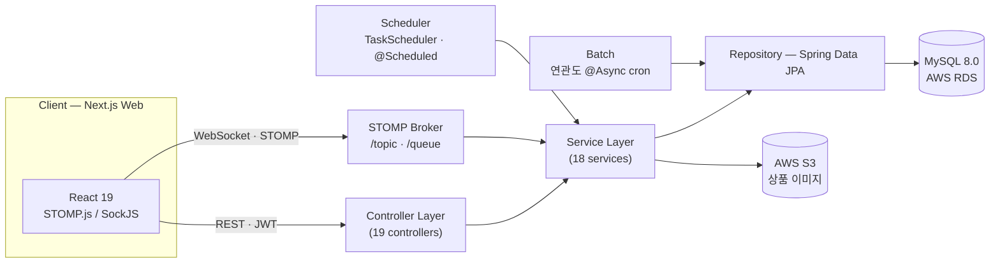
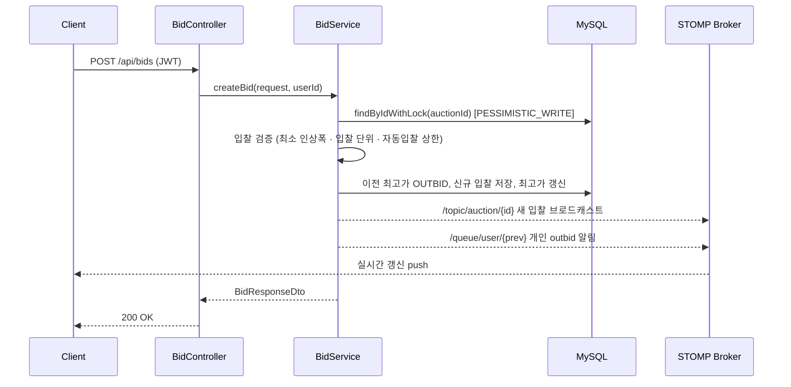
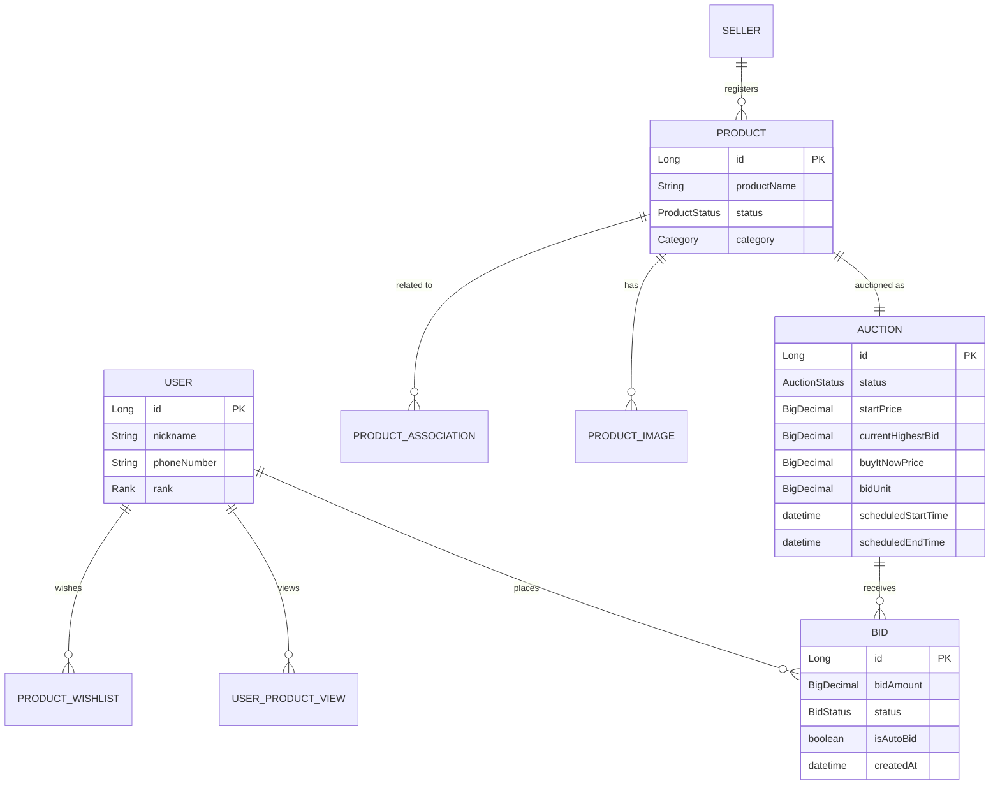

# Highlight Backend

[](https://openjdk.org/)
[](https://spring.io/projects/spring-boot)
[](https://spring.io/projects/spring-security)
[](https://stomp.github.io/)
[](https://www.mysql.com/)
[](https://aws.amazon.com/)
[](https://www.docker.com/)

> **실시간 경매 플랫폼 [Highlight](https://github.com/blaybus-highlight)의 백엔드 API 서버.**
> 다수 사용자가 동시에 경합하는 입찰 환경에서 **데이터 정합성 · 실시간성 · 경매 생명주기 자동화**를 핵심 과제로 삼아 설계했습니다.
>
> 2025 블레이버스 MVP 개발 해커톤 시즌2 수상작 · 개발 기간 2025.08 (약 1개월)

---

## 기술적 하이라이트

경매는 "같은 순간, 같은 물건, 여러 사람"이 부딪히는 도메인입니다. 이 서버는 그 경합 지점을 어떻게 안전하고 빠르게 처리하는가에 집중했습니다.

### 1. 동시 입찰 정합성 — Pessimistic Lock

여러 사용자가 **동시에 같은 경매**에 입찰하면 race condition으로 최고가가 덮어써지거나 중복 낙찰이 발생할 수 있습니다. 입찰 트랜잭션 진입 시점에 해당 `Auction` 행에 **배타 락(`PESSIMISTIC_WRITE`)** 을 걸어, `검증 → 이전 최고가 OUTBID 전환 → 신규 입찰 저장 → 최고가 갱신`을 하나의 원자적 흐름으로 직렬화합니다.

```java
// AuctionRepository
@Lock(LockModeType.PESSIMISTIC_WRITE)
@Query("SELECT a FROM Auction a WHERE a.id = :auctionId")
Optional<Auction> findByIdWithLock(@Param("auctionId") Long auctionId);
```

- 최소 인상폭(`minimumBid`)·입찰 단위(`bidUnit`) 검증, 동일가 입찰은 **선착순** 우선
- 자동 입찰(auto-bid) 상한 검증
- 밀려난 이전 최고 입찰자는 즉시 `OUTBID` 상태로 전환하고 개인 알림 발송

### 2. 실시간 경매 — WebSocket over STOMP

STOMP 메시지 브로커 + **SockJS fallback**(`/ws`, `/ws/auctions`, `/ws/direct`)으로 실시간 채널을 구성하고, 브로드캐스트와 개인 알림을 **채널 단위로 분리**했습니다.

| 채널 | 용도 |
|------|------|
| `/topic/auction/{id}` | 1:N — 경매별 실시간 정보(새 입찰·현재가·상태·카운트다운) |
| `/topic/auctions` | 1:N — 전체 경매 목록 변경 스트림 |
| `/queue/user/{id}/notifications` | 1:1 — 개인 outbid 알림 |

입찰 한 건이 성사되면 구독자 전원에게 최고가를 push 하는 동시에, **밀려난 직전 최고 입찰자에게만** 개인 큐로 알림을 보냅니다.

### 3. 경매 생명주기 자동화 — Dynamic Scheduling + Self-Healing

```java
// 경매별 시작 시각에 맞춰 개별 예약, ScheduledFuture로 취소·재예약 관리
ScheduledFuture<?> task = taskScheduler.schedule(() -> startAuction(id), startTime);
scheduledTasks.put(auctionId, task);   // ConcurrentHashMap<Long, ScheduledFuture<?>>
```

- **동적 예약**: 경매마다 `TaskScheduler`로 시작 시각을 예약하고 `ConcurrentHashMap`으로 개별 취소·재예약
- **안전망(self-healing)**: 서버 재시작·예약 누락에 대비해 **1분 주기 스윕**으로 놓친 시작/만료 종료를 자동 복구하고 상품 상태를 동기화
- **1초 카운트다운**: 진행 중 경매의 남은 시간을 초 단위로 브로드캐스트

### 4. 연관 상품 추천 — 조회 이력 기반 배치

사용자 조회 이력(`UserProductView`)을 분석해 **함께 본 상품(co-view)** 연관도를 계산하고, 상세 페이지 추천에 활용합니다.

- `@Scheduled(cron = "0 0 3 * * *")` — 매일 새벽 3시 `@Async` 배치로 최근 30일 이력 집계 → `ProductAssociation` 갱신
- `@Scheduled(cron = "0 0 4 * * 0")` — 매주 일요일 새벽 4시 오래된 연관 데이터 정리

### 5. 인증 · 예외 설계

- **JWT Access/Refresh** 이중 토큰, `JwtAuthenticationFilter`를 시큐리티 필터체인 선두에 배치, 세션은 `STATELESS`
- **CoolSMS** 휴대폰 본인인증 기반 회원가입/로그인
- 도메인별 `ErrorCode` enum + `BusinessException` + `@RestControllerAdvice` `GlobalExceptionHandler`로 **일관된 에러 응답** 규격화

---

## 아키텍처



**Layered Architecture** — `Controller → Service → Repository → Domain`, 횡단 관심사는 `security` · `exception` · `util` · `validation`으로 분리.

---

## 입찰 처리 흐름



---

## 데이터 모델 (ERD)



> `AuctionStatus`: `SCHEDULED → IN_PROGRESS → COMPLETED / FAILED / CANCELLED` · `BidStatus`: `WINNING / OUTBID / WON`

---

## 기술 스택

| 구분 | 기술 |
|------|------|
| **Framework** | Spring Boot 3.4.5 (Java 17), Spring Data JPA, Spring Security, Spring WebSocket(STOMP) |
| **Database** | MySQL 8.0 (AWS RDS) · H2 (테스트) |
| **Realtime** | STOMP over WebSocket · SockJS fallback |
| **Auth** | JWT (Access/Refresh) · CoolSMS 휴대폰 인증 |
| **Storage** | AWS S3 (상품 이미지) |
| **Infra** | AWS EC2 · Docker · Docker Compose |
| **CI/CD** | GitHub Actions → Docker Hub → EC2 |
| **Docs** | Swagger / OpenAPI 3.0 · Spring Actuator |

---

## 프로젝트 구조

```
src/main/java/com/highlight/highlight_backend/
├── config/         # Security · WebSocket(STOMP) · Scheduling · CORS · Swagger
├── controller/     # REST API (19) + WebSocket 컨트롤러
├── service/        # 비즈니스 로직 (18) — 입찰 · 경매 스케줄러 · 추천 배치 등
├── domain/         # JPA 엔티티 (12)
├── repository/     # Spring Data JPA + Specification (동적 검색)
├── dto/            # 요청/응답 · WebSocket 메시지 DTO
├── security/       # JWT 인증 필터
├── exception/      # 도메인별 ErrorCode + 전역 예외 처리
├── validation/     # 커스텀 검증 (@ValidPassword)
└── util/           # JWT · 인증 · 응답 유틸
```

---

## 로컬 실행

**요구사항**: Java 17+ · Docker & Docker Compose

```bash
# 1) 클론
git clone https://github.com/blaybus-highlight/backend.git
cd backend

# 2) .env 작성 (DB / JWT / AWS S3 / CoolSMS 등)
#    docker-compose.yml 참고

# 3) 전체 스택 실행 (MySQL + Backend)
docker-compose up -d
docker-compose logs -f highlight-backend

# — 또는 로컬 개발 실행 —
docker-compose up -d highlight-db   # DB만 컨테이너로
./gradlew bootRun

# 테스트
./gradlew test
```

---

## API 문서

- **Swagger UI**: `http://<host>:8085/swagger-ui/index.html`
- **OpenAPI JSON**: `http://<host>:8085/api-docs`

대표 엔드포인트

| Method | Path | 설명 |
|--------|------|------|
| `POST` | `/api/auth/phone/send` · `/verify` | SMS 인증코드 발송/검증 |
| `POST` | `/api/auth/signup` · `/login` | 회원가입 / 로그인(JWT 발급) |
| `GET`  | `/api/products/{id}` | 상품 상세 (연관 상품 포함) |
| `GET`  | `/api/auctions` | 경매 목록 조회 |
| `GET`  | `/api/auctions/{id}/status` | 실시간 경매 상태 |
| `POST` | `/api/bids` | 입찰하기 (락 기반 처리) |
| `POST` | `/api/buy-now` | 즉시구매 |

---

## CI/CD

`main` 브랜치 push → **GitHub Actions**가 Gradle 빌드 → Docker 이미지 빌드 & **Docker Hub** push → SSH로 **EC2** 배포까지 자동화.

```
push(main) → Gradle build → Docker build&push → Docker Hub → EC2 pull&run
```
